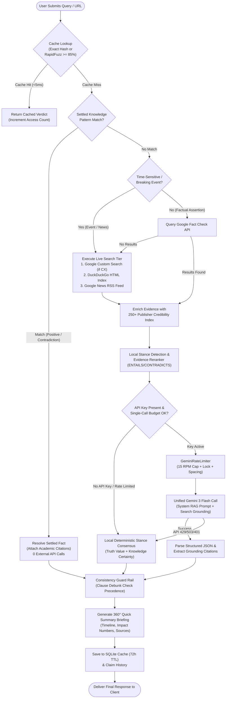

# TruthLens External Integrations & Verification Services

This document details all external APIs, web scraping channels, local heuristic catalogs, rate limiters, fallback mechanisms, and authentication workflows that comprise the TruthLens verification engine.

---

## 1. Multi-Tier Verification Pipeline Overview

TruthLens operates on a multi-tier fallback architecture designed to maximize accuracy, eliminate hallucination, and prevent API rate-limit exhaustion. Identical or settled queries resolve in milliseconds with **zero external API calls**, while breaking events leverage real-time Google Search Grounding.



---

## 2. Google Gemini API Integration (`google-genai` SDK)

### 2.1 Overview & Responsibilities
TruthLens uses the official `google-genai` Python SDK to interact with Google's latest Gemini models for single-pass unified RAG verdict synthesis, clause-by-clause assertion analysis, and structured 360° incident briefings.

- **Primary Target Model**: `gemini-3.1-flash-live-preview` (ultra-low latency, real-time reasoning).
- **Fallback Candidate Chain**:
  ```python
  [
      "gemini-3.1-flash-live-preview",
      "gemini-3-flash-preview",
      "gemini-3.6-flash",
      "gemini-3.5-flash-lite",
      "gemini-2.5-flash",
      "gemini-2.0-flash",
      "gemini-flash-latest"
  ]
  ```
- **Single-Call Budget Rule**: Under no circumstances may a single user query trigger more than **one** Gemini call. All classification, reranking, and search preparation are performed upstream locally.

### 2.2 Client-Side Concurrency & Rate Limiter (`GeminiRateLimiter`)

Located at `backend/app/services/gemini_rate_limiter.py`, this component enforces safe client-side governance to prevent upstream 429 quota exhaustion on free-tier keys:

1. **Sliding-Window RPM Limiter**:
   - Maintains a timestamp deque (`_timestamps: deque`) across a rolling 60-second window.
   - Enforces `GEMINI_MAX_RPM` (default: 15 RPM).
   - If approaching the limit within 4 seconds of clearance, the limiter sleeps until the window opens; if backlog exceeds 4s, it raises `GeminiRateLimitException`.
2. **Minimum Inter-Call Delay**:
   - Enforces a mandatory minimum spacing of `0.5s` (`GEMINI_MIN_INTER_CALL_DELAY_SEC`) between consecutive Gemini requests.
3. **Concurrency Serialization**:
   - Implements `asyncio.Lock()` to serialize outbound calls, ensuring concurrent requests cannot trigger burst spikes.
4. **Exponential Backoff**:
   - Retries transient upstream `429` (Resource Exhausted) and `503` (Service Unavailable) up to `GEMINI_MAX_RETRIES` (2 retries) with exponential doubling: $1.5\text{s} \rightarrow 3.0\text{s}$.
5. **Fast-Fail Exception Handling**:
   - **401 / 403 (Auth / Invalid Key)**: Immediately raises `GeminiAuthException` without retries. Inspects key prefix: if key does not start with `AIzaSy` (standard Google AI Studio format), it warns the user that an OAuth access token was provided instead of an API key.
   - **404 (Model Not Found)**: Raises `GeminiNotFoundException` immediately, triggering automatic fallback to the next candidate model in the chain.

### 2.3 Prompt Engineering & Structured JSON Output

The system prompt (`RAG_SYNTHESIS_SYSTEM_PROMPT` in `backend/app/services/gemini_service.py`) instructs Gemini to act as an objective verification engine:

```json
{
  "mode": "Claim Verification | Event Query | Hybrid",
  "claim": "string",
  "truth_value": "TRUE | FALSE | LIKELY_TRUE | LIKELY_FALSE | MIXED | UNVERIFIABLE",
  "knowledge_certainty": "SETTLED | DEBATED | EMERGING | INSUFFICIENT",
  "final_verdict_display": "string",
  "confidence": 0-100,
  "reasoning_summary": "2-3 sentences",
  "event_meta": {
    "category_emoji": "🌊",
    "category_label": "Natural Disaster — Flooding",
    "title": "Clear descriptive event title",
    "region": "Affected geographical area",
    "date_range": "Time window",
    "status": "🔴 Ongoing | 🟡 Developing | 🟢 Resolved"
  },
  "evidence_analysis": [
    {"source": "string", "stance": "ENTAILS | CONTRADICTS | NEUTRAL", "reason": "string"}
  ],
  "claim_breakdown": [
    {"clause": "string", "status": "debunked | verified | accurate | misleading | unverified", "note": "string"}
  ],
  "quick_summary": {
    "what_happened": "Core factual incident summary",
    "full_context": "Historical and structural context",
    "timeline": ["YYYY-MM-DD — Development"],
    "impact_numbers": {
      "deaths": "string",
      "displaced": "string",
      "areas_affected": "string",
      "damage": "string",
      "rescue": "string"
    },
    "key_parties": [{"name": "string", "role": "string"}],
    "key_data": ["Important metric"],
    "perspectives": [{"party": "string", "stance": "string"}],
    "current_status": "Current situation",
    "key_takeaway": "Bottom line summary"
  },
  "sources_and_reading": [
    {
      "source_name": "string",
      "title": "Exact headline",
      "url": "https://...",
      "date_published": "YYYY-MM-DD",
      "source_type": "[🟢 Primary Source] | [🔵 Major News Outlet] | [🟡 Fact-Checker] | [🟠 Domain Expert / Academic] | [⚪ Other / General]",
      "paywall": false,
      "archive_url": "https://..."
    }
  ]
}
```

### 2.4 Parsing Resilience
- Handles standard JSON responses via `response_mime_type="application/json"`.
- Automatically catches models lacking strict JSON constraint support and retries cleanly.
- Implements markdown fence stripping (````json ... ````) and secondary regex object matching (`re.search(r'(\{.*\})', raw_text, re.DOTALL)`).

---

## 3. Google Live Search Grounding Integration

When verifying breaking news, current events, or queries where no prior fact checks exist, TruthLens enables native **Google Search Grounding**:

### 3.1 Grounding Tool Activation
Inside `backend/app/services/gemini_service.py`:
```python
from google.genai import types

if use_search_grounding:
    config_params["tools"] = [types.Tool(google_search=types.GoogleSearch())]
```

### 3.2 Metadata Extraction & Citation Conversion
Grounding metadata returned by Gemini is parsed from `response.candidates[0].grounding_metadata.grounding_chunks`:
1. Extracts `chunk.web.uri` and `chunk.web.title`.
2. Normalizes domain via `urllib.parse.urlparse(uri).netloc`.
3. Maps citations into the standard TruthLens `SourceEvidence` data model with calculated confidence contributions.

---

## 4. Google Fact Check Tools API Integration

### 4.1 Endpoint & Authentication
- **Endpoint**: `https://factchecktools.googleapis.com/v1alpha1/claims:search`
- **Authentication**: Query parameter `key={GOOGLE_FACTCHECK_API_KEY}` (falls back to `GOOGLE_API_KEY`).
- **Parameters**:
  - `query`: The checkable claim string.
  - `languageCode`: Target language code (default: `"en"`).
  - `pageSize`: `5`.

### 4.2 Rating Normalization Mapping (`RATING_MAP`)
Fact-checkers use hundreds of disparate rating labels. `FactCheckService.normalize_rating()` maps these into 5 standard TruthLens verdicts:

| Standard Verdict | Normalized Raw Phrases (Case-Insensitive Substrings) |
| :--- | :--- |
| **`False`** | `false`, `pants on fire`, `mostly false`, `barely true`, `four pinocchios`, `three pinocchios`, `incorrect`, `fake`, `hoax`, `debunked`, `untrue`, `wrong`, `fabricated`, `scam`, `falso`, `faux`, `alterado`, `manipulated`, `inaccurate`, `not true` |
| **`Misleading`** | `misleading`, `missing context`, `needs context`, `half true`, `partly true`, `partially true`, `two pinocchios`, `exaggerated`, `distorted`, `unsupported`, `out of context`, `selective`, `mixture`, `half flip` |
| **`True`** | `true`, `correct`, `accurate`, `verified`, `mostly true`, `one pinocchio`, `supported`, `confirmed`, `fact`, `vrai` |
| **`Satire`** | `satire`, `parody`, `humor`, `satirical` |
| **`Unverified`** | `unproven`, `unverified`, `unclear`, `no evidence`, `unsubstantiated`, `inconclusive`, `disputed` |

### 4.3 Curated Offline Fact-Check Fallback
If the API key is unconfigured or returns HTTP errors, `FactCheckService.match_offline_database()` queries `OFFLINE_FACT_CHECKS` containing verified records for major recurring viral hoaxes (e.g. garlic curing COVID, 5G virus transmission, James Webb WASP-96b findings, Pope Trump endorsement, bananas & cancer TNF, Mars alien pyramids, EV lifecycle emissions, hollow moon satire).

---

## 5. Web Search & News Aggregation Integrations

TruthLens implements a three-stage fallback search pipeline to retrieve live web corroboration:

```
[Target Query]
      │
      ▼
1. Google Custom Search JSON API (if CSE CX & Key configured)
      │ (Fallback if no CX or 0 results)
      ▼
2. DuckDuckGo HTML Live Web Index (Public, Zero-Key)
      │ (Fallback if blocked or 0 results)
      ▼
3. Google News RSS Feed (Public XML Feed + Semantic Relevance Filter)
```

### 5.1 Google Custom Search JSON API
- **Endpoint**: `https://customsearch.googleapis.com/customsearch/v1`
- **Credentials**: `GOOGLE_SEARCH_API_KEY` + `GOOGLE_SEARCH_ENGINE_ID` (`cx`).
- **Parsing**: Inspects `title`, `snippet`, `link`, and `displayLink`. Confirms events using keywords (`killed`, `flooded`, `struck`, `authorities confirm`, etc.).

### 5.2 Open Live Web Search (DuckDuckGo HTML)
- **Endpoint**: `https://html.duckduckgo.com/html/?q={encoded_query}`
- **Zero-Key Requirement**: Operates without requiring third-party API credentials.
- **Implementation**:
  - Sets browser-standard `User-Agent` and headers.
  - Parses HTML using BeautifulSoup (`div.result`, `div.web-result`).
  - Unquotes redirect links by extracting `uddg` query parameter values.
  - Filters candidates by strict semantic relevance ($\ge 55.0$).

### 5.3 Google News RSS Feed Search
- **Endpoint**: `https://news.google.com/rss/search?q={query}&hl=en-US&gl=US&ceid=US:en`
- **Parsing**: XML parsing via `xml.etree.ElementTree`.
- **Semantic Relevance Algorithm (`NewsCrossReferenceService.calculate_relevance`)**:
  - Strips punctuation and stop words (`STOP_WORDS`).
  - Calculates token intersection ratio:
    $$\text{Overlap Ratio} = \frac{|\text{Tokens}_{\text{claim}} \cap \text{Tokens}_{\text{title}}|}{|\text{Tokens}_{\text{claim}}|}$$
    *(Penalizes loose overlaps if claim has $\ge 3$ tokens but only 1 matches)*.
  - Computes `RapidFuzz` metrics: `token_set_ratio` and `partial_ratio`.
  - Weighted combined relevance formula:
    $$\text{Score} = (\text{Overlap Ratio} \times 45.0) + (\text{Token Set Ratio} \times 0.35) + (\text{Partial Ratio} \times 0.20)$$
  - Strict admission threshold: $\text{Score} \ge 55.0$.

---

## 6. Internal Knowledge Tiers & Algorithmic Services

### 6.1 Settled Knowledge Engine (0 External API Calls)
Located in `backend/app/services/factcheck_service.py`:
- Identifies invariant physical, astronomical, geographic, and biological facts using compiled regular expressions:
  - **Positive Settled Facts**: Earth orbits sun, sun rises in east, water boils at 100°C / freezes at 0°C, speed of light, Paris is capital of France, humans require oxygen.
  - **Contradicted Inverted Facts**: Sun rises in west, sun sets in east, earth is flat, water boils at 50°C, moon made of cheese, Paris is capital of Germany.
- Directly attaches 2–4 authoritative reference sources (NASA, NIST, NOAA, NIH/NCBI, Encyclopedia Britannica, French Republic Official Portal).
- Resolves instantaneously with **zero latency** and **zero API consumption**.

### 6.2 Consistency Guard Rail Architecture
Located in `backend/app/services/synthesis_service.py`:
- Enforces an automated safety constraint before rendering verdicts:
  - Scans all clause statuses in `claim_breakdown`.
  - Scans stance evaluations in `reranked_docs`.
  - **Constraint Rule**: If any clause is marked `debunked`, `false`, or `unsupported` (or any evidence document exhibits a `CONTRADICTS` stance), the final verdict is strictly **prohibited** from being `True`.
  - If conflicting true and false clauses coexist, the verdict is downgraded to `Misleading`; if only debunked clauses exist, it is forced to `False`.

### 6.3 Misinformation Pattern & Red Flag NLP
Located in `backend/app/services/pattern_analyzer.py`:
- Analyzes text across 7 categories:
  1. **ALL CAPS Ratio**: Shouting/alarmism detection (e.g. $>30\%$ capitalized words).
  2. **Excessive Punctuation**: `!!!`, `???`, `!?!`.
  3. **Clickbait Hooks**: Curiosity gaps (*"you won't believe"*, *"what happens next"*, *"miracle cure"*).
  4. **Emotional Manipulation**: Inflammatory language (*"pure evil"*, *"bloodbath"*, *"catastrophic"*).
  5. **Unverified Attribution**: Anonymous/vague authority (*"scientists say"*, *"everyone knows"*).
  6. **Conspiracy Tropes**: Documented conspiracy patterns (*"deep state"*, *"5g causes"*, *"crisis actors"*).
  7. **Statistical Integrity**: Fabricated figures (*"1000% increase"*, *"millions dead secretly"*).
- Outputs a normalized Red Flag Score (0–100) and risk tier (`Clean`, `Low`, `Moderate`, `High`).

### 6.4 Publisher Credibility Index
Located in `backend/app/services/credibility_service.py` and `backend/app/db/seed_data.py`:
- Curated reference catalog of over 250 media organizations.
- URL domain extraction, clean hostname isolation, and subdomain stripping (e.g. `news.bbc.co.uk` $\rightarrow$ `bbc.co.uk`).
- Trust Tier assignment:
  - `90 - 100`: Top-Tier Credible (Verified / Scientific)
  - `75 - 89`: Generally Reliable / Mainstream
  - `55 - 74`: Mixed Reliability / Editorial Bias
  - `40 - 54`: Questionable / Low Reliability
  - `0 - 39`: High-Risk / Conspiracy / Fake News
- Automatic heuristic identification for government and educational top-level domains (`.gov`, `.edu`, `.mil`, `.gov.uk`, `.gov.in`) assigned a baseline trust score of 92.

### 6.5 Fuzzy SQLite Deduplication Cache
Located in `backend/app/services/cache_service.py`:
- **Tier 1 (Exact Match)**: SHA-256 hash of normalized, punctuation-stripped input.
- **Tier 2 (Fuzzy Match)**: Evaluates candidate unexpired entries using `rapidfuzz.fuzz.token_set_ratio`. If token similarity $\ge 85.0\%$, returns cached verification payload with `cached=True`, `is_fuzzy_match=True`, and similarity score.
- Increments `access_count` on every hit.
- 72-hour TTL expiration. Prevents caching when synthesis results in a service error.

---

## 7. Dynamic Key Configuration & Runtime Management

TruthLens provides dynamic runtime API key updating without requiring backend restarts:

### 7.1 Configuration Endpoints (`backend/app/api/routes_config.py`)

- **`GET /api/config/status`**:
  Returns current service capabilities and key presence status:
  ```json
  {
    "status": "online",
    "model": "gemini-3.1-flash-live-preview",
    "keys": {
      "google_api_key": true,
      "gemini_api_key": true,
      "factcheck_api_key": true,
      "google_search_key": false,
      "news_api_key": false
    },
    "capabilities": {
      "google_search_grounding": true,
      "gemini_fact_synthesis": true,
      "google_factcheck_tools_api": true,
      "settled_knowledge_engine": true,
      "news_consensus_engine": true,
      "misinformation_pattern_nlp": true,
      "fuzzy_deduplication_cache": true
    }
  }
  ```

- **`POST /api/config/set-key`**:
  Receives `{ "google_api_key": "AIzaSy..." }`.
  1. Updates runtime in-memory `settings` object immediately.
  2. Updates `os.environ` keys for `GOOGLE_API_KEY`, `GEMINI_API_KEY`, and `GOOGLE_FACTCHECK_API_KEY`.
  3. Writes updated key directly to root `P:\TruthLens\.env` for persistence across system restarts.

---

## 8. Integration Resilience & Fallback Matrix

| Integration / Service | Primary Role | Required Credentials | Fallback Behavior on Failure / Absence |
| :--- | :--- | :--- | :--- |
| **Local SQLite Cache** | Instant retrieval of prior queries | None | Falls through to Settled Knowledge check. |
| **Settled Knowledge Engine** | Verifies universal physical & geographic facts | None | Falls through to live fact-check / search tier. |
| **Google Gemini 3 Flash** | Reasoning, stance synthesis & 360° briefing | `GOOGLE_API_KEY` or `GEMINI_API_KEY` | Falls back to local deterministic stance consensus; returns verdict with `llm_enhanced: false` and explanatory warning. |
| **Google Search Grounding** | Real-time web evidence retrieval for breaking events | `GOOGLE_API_KEY` | Falls back to DuckDuckGo open web search + Google News RSS feed. |
| **Google Fact Check API** | Queries accredited fact-checker databases | `GOOGLE_FACTCHECK_API_KEY` or `GOOGLE_API_KEY` | Falls back to local curated offline database of viral hoaxes. |
| **Google Custom Search API** | Programmable web search index | `GOOGLE_SEARCH_API_KEY` + `GOOGLE_SEARCH_ENGINE_ID` | Falls back to DuckDuckGo HTML open web search. |
| **DuckDuckGo Open Search** | Zero-key live web corroboration | None | Falls back to Google News RSS feed search. |
| **Google News RSS Feed** | Corroborates breaking events against news outlets | None | Returns unverified verdict if all search tiers return 0 results. |
| **Trafilatura Web Extractor**| Extracts article body from submitted URL | None | Falls back to BeautifulSoup OpenGraph metadata and `<title>` tag. |
