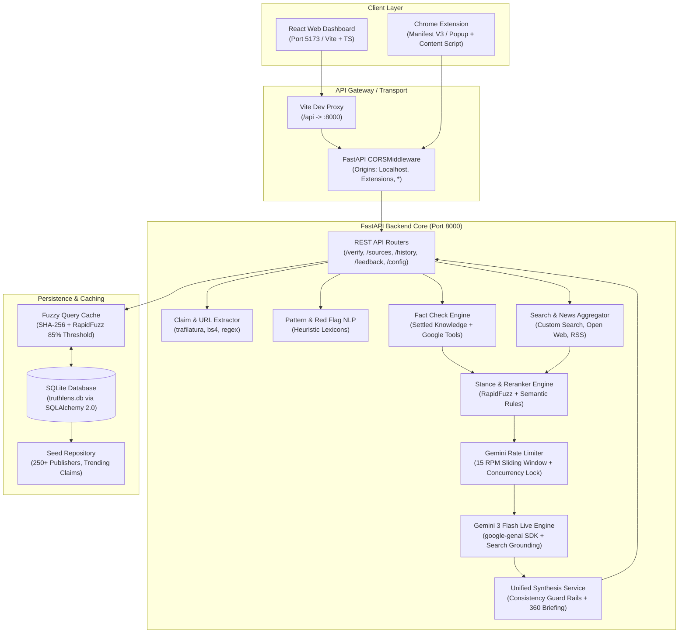

# TruthLens Technology Stack Documentation

This document provides a comprehensive analysis of the architectural layers, frameworks, libraries, runtime environments, configurations, and data persistence models that power the TruthLens platform across backend, frontend, and browser extension surfaces.

---

## 1. System Architecture Overview

TruthLens is structured as a decoupled full-stack platform consisting of three primary runtime subsystems:
1. **Backend Engine**: A Python FastAPI REST service handling natural language understanding, claim extraction, multi-source fact retrieval, stance detection, and synthesis.
2. **Frontend Dashboard**: A modern React single-page application (SPA) built with TypeScript, Vite, and Tailwind CSS, providing claim verification, batch article checking, and analytics.
3. **Browser Extension**: A Manifest V3 Chrome extension providing in-page text selection verification via background service workers and dynamic content script injection.



---

## 2. Backend Technology Stack

The backend is built in Python (3.10+) and runs as an asynchronous ASGI application.

### 2.1 Core Runtime & Web Framework

| Technology | Version / Spec | Purpose / Implementation |
| :--- | :--- | :--- |
| **Python** | `>=3.10` (tested on 3.11) | Core programming language leveraging modern typing, `asyncio`, and pattern matching. |
| **FastAPI** | `>=0.110.0` | High-performance async web framework. Implements lifespan state management, automated OpenAPI documentation (`/docs`, `/redoc`), and dependency injection (`Depends(get_db)`). |
| **Uvicorn** | `>=0.28.0` (`uvicorn[standard]`) | Lightning-fast ASGI web server implementation based on `uvloop` and `httptools`. Configured for hot-reloading on `127.0.0.1:8000`. |
| **Pydantic** | `>=2.6.0` | Data validation, serialisation, and request payload schema definitions (`VerifyRequest`, `ArticleVerifyRequest`, `FeedbackRequest`, `SetKeyRequest`). |
| **Pydantic-Settings** | `>=2.2.0` | Environment settings management using `BaseSettings` reading from root `.env` with fallback defaults. |

### 2.2 Database & Object-Relational Mapping (ORM)

TruthLens uses a self-contained embedded SQLite database designed for zero external infrastructure dependencies.

| Component | Implementation Details |
| :--- | :--- |
| **ORM** | **SQLAlchemy `>=2.0.28`** using the 2.0 declarative API (`declarative_base()`, `SessionLocal`). |
| **Database Driver** | Python standard library `sqlite3` accessed via `sqlite:///truthlens.db`. |
| **Concurrency Setup** | Configured with `connect_args={"check_same_thread": False}` to allow cross-thread session reuse in async request handlers. |
| **Session Lifecycle** | Managed per-request via FastAPI dependency generator `get_db()`, ensuring deterministic session closing. |
| **Schema Creation** | Automatic schema creation on application startup (`Base.metadata.create_all(bind=engine)`) within the FastAPI `lifespan` handler. |

#### Database Schema Architecture (`backend/app/db/models.py`)

1. **`query_cache`**:
   - `id`: Integer primary key, indexed.
   - `query_hash`: SHA-256 hex digest (64 chars) of normalized input text, indexed.
   - `normalized_query`: Lowercase, punctuation-stripped query representation for fuzzy token matching.
   - `input_text`: Original raw user input.
   - `extracted_claim`: Core factual claim isolated by the extractor.
   - `verdict`: Final synthesized verdict (`True`, `False`, `Misleading`, `Unverified`, `Satire`).
   - `confidence`: Confidence float score (0.0 – 100.0).
   - `category`: Thematic category (Health, Politics, Science, etc.).
   - `sources_json`: Serialized JSON array of cited sources and credibility scores.
   - `red_flags_json`: Serialized JSON object containing linguistic red flag flags and checklists.
   - `explanation_json`: Serialized JSON explanation payload including why bullets and private metadata.
   - `credibility_json`: Publisher credibility assessment.
   - `access_count`: Integer tracking cache hit frequencies.
   - `created_at` / `expires_at`: UTC timestamps enforcing a configurable 72-hour TTL.

2. **`claim_history`**:
   - Audit trail of all processed claims.
   - Fields: `id`, `input_text`, `extracted_claim`, `verdict`, `confidence`, `category`, `sources_count`, `red_flag_score`, `explanation_summary`, `created_at`.

3. **`trending_claims`**:
   - Curated and live trending misinformation claims monitored across domains.
   - Fields: `id`, `claim_text`, `verdict`, `confidence`, `category`, `summary`, `source_name`, `source_url`, `search_volume`, `last_checked`.

4. **`publisher_credibility`**:
   - Media outlet reference index with over 250 seeded organizations.
   - Fields: `id`, `domain` (unique, indexed), `name`, `category` (Fact-Checker, Mainstream, Satire, Conspiracy/Fake, State-Sponsored), `bias_rating` (Left, Lean Left, Center, Lean Right, Right, Extreme, Satire), `factual_reporting` (Very High, High, Mostly Factual, Mixed, Low, Very Low), `credibility_score` (0–100 integer), `country`, `notes`, `mbfc_url`.

5. **`user_feedback`**:
   - Community evaluation log for verified claims.
   - Fields: `id`, `claim_id`, `claim_text`, `given_verdict`, `feedback_type` (`helpful` | `incorrect`), `suggested_verdict`, `comments`, `created_at`.

### 2.3 Network, Scraping & Content Processing

| Library | Version | Usage in TruthLens |
| :--- | :--- | :--- |
| **HTTPX** | `>=0.27.0` | Asynchronous HTTP client (`httpx.AsyncClient`) with connection pooling, configurable timeouts (7–10s), and redirect following for external Google APIs, DuckDuckGo open search, and Google News RSS. |
| **Aiohttp** | `>=3.9.3` | Async HTTP engine supporting concurrent background network polling. |
| **Trafilatura** | `>=1.8.0` | Main text discovery and HTML extraction engine used by `ClaimExtractor.extract_from_url()` to extract clean article text from arbitrary URLs while discarding boilerplate, navigation, and ads. |
| **BeautifulSoup4** | `>=4.12.3` | HTML document parser used for metadata extraction (OpenGraph tags, `<meta property="og:title">`, `<title>`, `<h1>`) and parsing DuckDuckGo HTML search results. |
| **lxml** | `>=5.1.0` | High-performance C-based HTML/XML parser backing Trafilatura and BeautifulSoup. |
| **RapidFuzz** | `>=3.6.0` | High-speed C++ fuzzy string matching library. Used for: (1) SQLite cache deduplication (`fuzz.token_set_ratio` >= 85.0%), (2) Semantic relevance scoring between news headlines and claim propositions, and (3) Antonym and semantic similarity in stance detection. |
| **google-genai** | `>=0.1.1` | Official Google GenAI SDK for Gemini 3 / Gemini 2 models and Google Search Grounding tool invocation. |

---

## 3. Frontend Technology Stack

The TruthLens frontend is an interactive single-page dashboard optimized for real-time verification and rich evidence visualisations.

### 3.1 Framework & Core Build System

| Tool | Version | Configuration & Role |
| :--- | :--- | :--- |
| **React** | `^18.2.0` | Component-based view layer utilizing hooks (`useState`, `useEffect`, `useCallback`, `useMemo`). |
| **ReactDOM** | `^18.2.0` | React DOM renderer with concurrent mode features. |
| **TypeScript** | `^5.2.2` | Strong static typing. Configured with `"target": "ES2020"`, `"moduleResolution": "bundler"`, and strict JSX transformation. |
| **Vite** | `^5.1.6` | Next-generation frontend build tool and dev server. Configured with `@vitejs/plugin-react`, running on port 5173 with proxy routing `/api` -> `http://127.0.0.1:8000`. |

### 3.2 Styling, Design System & Theming

The user interface follows a modern dark glassmorphic aesthetic built on Tailwind CSS:

| Tool | Version | Role |
| :--- | :--- | :--- |
| **Tailwind CSS** | `^3.4.1` | Utility-first CSS framework configured with dark mode class support, custom fonts (`Inter`, `Merriweather`, `JetBrains Mono`), and bespoke color scales. |
| **PostCSS** | `^8.4.35` | CSS transformation engine. |
| **Autoprefixer** | `^10.4.18` | Automatic vendor prefix injection for cross-browser styling consistency. |
| **clsx** | `^2.1.0` | Utility for constructing conditional class name strings cleanly. |
| **tailwind-merge** | `^2.2.1` | Merges Tailwind class strings safely without stylesheet conflicts. |

#### Design System Tokens (`frontend/tailwind.config.js`)
- **Brand Palette**: Deep sky blues (`brand-50` through `brand-950`).
- **Verdict Color Mapping**:
  - `verdict-true`: `#10b981` (Emerald green)
  - `verdict-false`: `#ef4444` (Rose red)
  - `verdict-misleading`: `#f59e0b` (Amber)
  - `verdict-unverified`: `#64748b` (Slate slate)
  - `verdict-satire`: `#8b5cf6` (Purple)
- **Glassmorphism**: `.glass-panel` and `.glass-panel-glow` with backdrop blur filters (`backdrop-filter: blur(16px)`).

### 3.3 UI Libraries & Utilities

| Package | Version | Usage |
| :--- | :--- | :--- |
| **lucide-react** | `^0.359.0` | Comprehensive collection of SVG iconography (shields, checkmarks, alert triangles, radar, external links, search, share). |
| **html-to-image** | `^1.11.11` | Client-side DOM-to-canvas image generator used in `ShareableCard.tsx` to render and download branded PNG verdict cards for social media sharing. |

### 3.4 Frontend Component Architecture (`frontend/src/components/`)

```
frontend/src/
├── api/
│   └── client.ts               # Typed fetch client wrapping all /api endpoints
├── types/
│   └── index.ts                # TypeScript domain models (VerificationResult, etc.)
├── components/
│   ├── Navbar.tsx              # Brand header, system status indicator, API Key manager trigger
│   ├── ApiKeysModal.tsx        # 1-Click dynamic Google API key configuration modal
│   ├── ClaimInput.tsx          # Dual mode input (single text/URL) with recency & settled fact pills
│   ├── VerdictCard.tsx         # Main composite card displaying final verdict, confidence & summary
│   ├── EventBriefingHeader.tsx # Mode B/C live event header (region, date range, status pill)
│   ├── QuickSummaryBriefing.tsx# 360° structured incident briefing (Timeline, Impact numbers, Parties)
│   ├── ConfidenceMeter.tsx     # Multi-factor confidence meter with itemized breakdown
│   ├── ExplainabilityPanel.tsx # Clause-by-clause assertion analysis and why bullets
│   ├── EvidenceTrail.tsx       # 5-tier source evidence citations with stances and domain filters
│   ├── PatternChecklist.tsx    # NLP red flags, clickbait analysis, and emotional manipulation score
│   ├── CredibilityLookup.tsx   # Publisher trust tier and bias inspector
│   ├── ShareableCard.tsx       # Exportable verdict card image generator (PNG download & copy)
│   ├── ArticleMode.tsx         # Batch multi-claim extraction and Article Trust Score calculator
│   ├── TrendingDashboard.tsx   # Live monitored viral hoaxes and claims with volume charts
│   ├── ClaimHistory.tsx        # Searchable and filterable history of past verifications
│   └── FeedbackModal.tsx       # Community feedback submission modal
└── App.tsx                     # Top-level state coordinator, tab switching, and error handling
```

---

## 4. Chrome Extension Technology Stack

The TruthLens Chrome Extension allows users to highlight text on any webpage and verify assertions inline.

### 4.1 Specification & Permissions (`extension/manifest.json`)

- **Manifest Version**: 3 (Google Chrome extension MV3 standard).
- **Permissions**:
  - `contextMenus`: Creates right-click menu item `"Verify with TruthLens"`.
  - `activeTab`: Accesses the active browser tab to inject status notifications.
  - `storage`: Stores extension preferences and local verification cache.
- **Host Permissions**:
  - `http://localhost:8000/*`
  - `http://127.0.0.1:8000/*`

### 4.2 Extension Component Breakdown

1. **Background Service Worker (`background.js`)**:
   - Registers context menu on install (`chrome.contextMenus.create`).
   - Listens for context menu clicks, extracts selected text.
   - Dispatches `TRUTHLENS_LOADING` message to the active tab's content script.
   - Performs async `fetch("http://localhost:8000/api/verify")` request.
   - Relays parsed result (`TRUTHLENS_RESULT`) or error (`TRUTHLENS_ERROR`) back to content script.

2. **Content Script (`content.js` & `content.css`)**:
   - Injected across all URLs (`<all_urls>`).
   - Listens for runtime messages from the service worker.
   - Injects a styled modal floating overlay (`#truthlens-injected-overlay`) showing verdict badge, confidence score, claim text, and summary with a direct link to the web dashboard.

3. **Popup Interface (`popup.html` & `popup.js`)**:
   - Dedicated browser toolbar action popup.
   - Provides an inline input textarea to type or paste a claim directly into the extension and view instant verification results.

---

## 5. Runtime, Execution & Orchestration Scripts

TruthLens includes standalone Windows command scripts to automate developer setup and startup.

| Script File | Target | Operating Commands |
| :--- | :--- | :--- |
| `P:\TruthLens\run_backend.bat` | Backend | Navigates to `backend`, launches Uvicorn ASGI server with hot reload: `python -m uvicorn app.main:app --reload --host 127.0.0.1 --port 8000`. |
| `P:\TruthLens\run_frontend.bat` | Frontend | Navigates to `frontend`, executes `npm.cmd run dev` on Vite port 5173. |
| `P:\TruthLens\start.bat` | Full System | Launches both Backend (port 8000) and Frontend (port 5173) in separate concurrent command windows with a 3-second initialization delay. |

---

## 6. Testing & Quality Assurance Stack

TruthLens implements automated test suites using `pytest` and FastAPI's `TestClient`.

### 6.1 Test Framework Configuration

- **Pytest**: `>=8.0.0`
- **Pytest-Asyncio**: `>=0.23.5`
- **Configuration File**: `P:\TruthLens\pytest.ini`
  ```ini
  [pytest]
  pythonpath = backend
  testpaths = backend/tests
  ```

### 6.2 Test Modules Breakdown (`backend/tests/`)

1. **`test_verification_pipeline.py`** (459 lines):
   - Tests end-to-end claim verification across all truth values.
   - Validates the single-Gemini-call budget enforcement (`gemini_calls_made <= 1`).
   - Verifies `GeminiRateLimiter` inter-call spacing (minimum 500ms delay).
   - Validates fast-fail mechanics on 404 (model not found) and 401 (invalid API key).
   - Tests time-sensitive query detection and search query normalization.
   - Tests settled knowledge pattern matches and contradiction detection.
   - Tests the Consistency Guard Rail preventing false claims from resolving as true.

2. **`test_credibility.py`**:
   - Tests domain normalization, subdomain stripping, and publisher trust score lookups.
   - Tests default fallback tiers for unranked and government/educational domains.

3. **`test_extractor.py`**:
   - Tests URL detection, prefix stripping (`"breaking news:"`, `"did you know that"`).
   - Tests core checkable proposition extraction from multi-sentence text.
   - Tests multi-claim batch extraction from articles.

4. **`test_pattern_analyzer.py`**:
   - Tests clickbait regex triggers, emotional manipulation detection, ALL CAPS scoring, and conspiracy pattern recognition.

---

## 7. Environment Configuration Matrix

TruthLens centralizes configuration in `backend/app/core/config.py` read from the root `.env` file:

| Variable | Type | Default Value | Description |
| :--- | :--- | :--- | :--- |
| `PROJECT_NAME` | String | `"TruthLens"` | Application branding name. |
| `VERSION` | String | `"1.0.0"` | Backend release version. |
| `API_PREFIX` | String | `"/api"` | Base path for all REST routes. |
| `GOOGLE_API_KEY` | String | `""` | Universal Google API Key (enables Gemini, Search Grounding, and Fact Check Tools API). |
| `GEMINI_API_KEY` | String | Fallback to `GOOGLE_API_KEY` | Explicit Gemini API Key override. |
| `GEMINI_MODEL` | String | `"gemini-3.1-flash-live-preview"` | Target Gemini LLM model identifier. |
| `GOOGLE_FACTCHECK_API_KEY`| String | Fallback to `GOOGLE_API_KEY` | Specific key for Google Fact Check Tools API. |
| `GOOGLE_SEARCH_API_KEY` | String | Fallback to `GOOGLE_API_KEY` | Specific key for Google Custom Search JSON API. |
| `GOOGLE_SEARCH_ENGINE_ID`| String | `""` | Custom Search Engine CX ID. |
| `NEWS_API_KEY` | String | `""` | Third-party news aggregator API key (optional). |
| `GEMINI_MAX_RPM` | Integer | `15` | Client-side rate limiter sliding window cap (safe free tier). |
| `GEMINI_MAX_RETRIES` | Integer | `2` | Number of retry attempts on upstream 429/503 errors. |
| `GEMINI_INITIAL_BACKOFF_SEC`| Float | `1.5` | Exponential backoff starting interval in seconds. |
| `GEMINI_MIN_INTER_CALL_DELAY_SEC`| Float | `0.5` | Minimum spacing enforced between consecutive Gemini calls. |
| `DATABASE_URL` | String | `sqlite:///truthlens.db` | SQLAlchemy connection string. |
| `CACHE_TTL_HOURS` | Integer | `72` | Cache expiration lifespan in hours. |
| `FUZZY_MATCH_THRESHOLD` | Float | `85.0` | RapidFuzz token similarity score threshold for cache hits. |
| `ALLOWED_ORIGINS` | List[str]| `["*"]` | Allowed CORS origins including extension schemes. |
